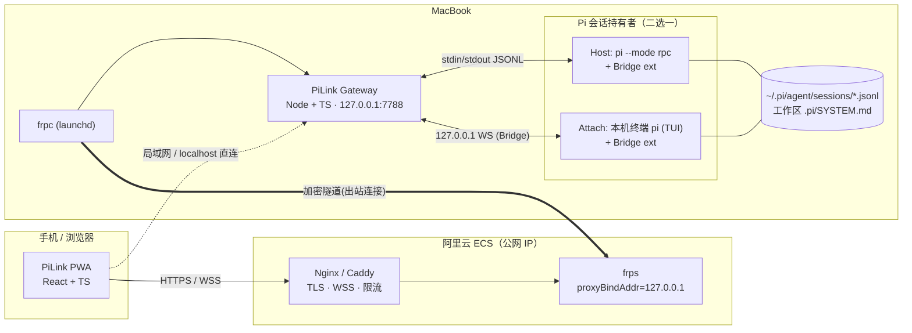
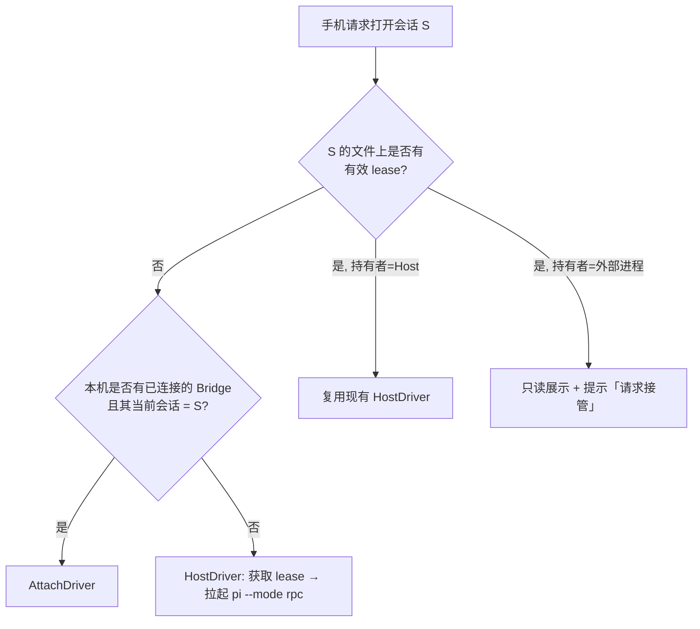
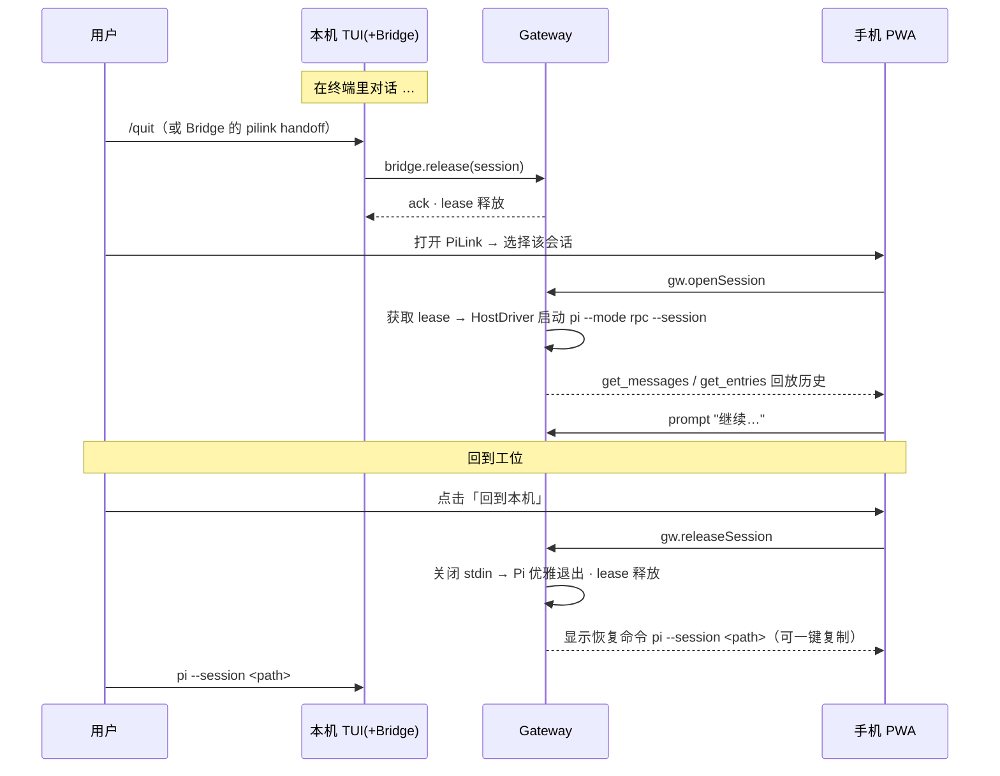
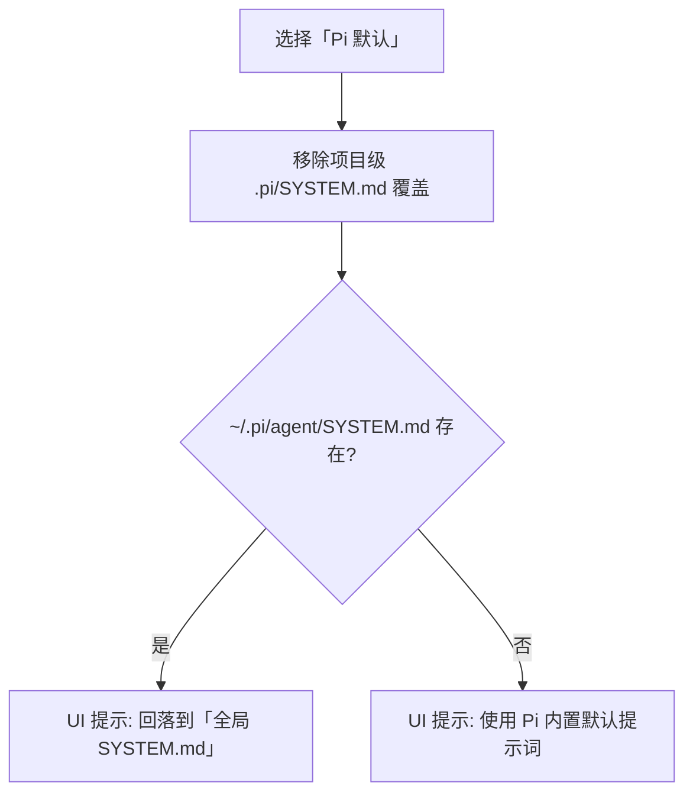
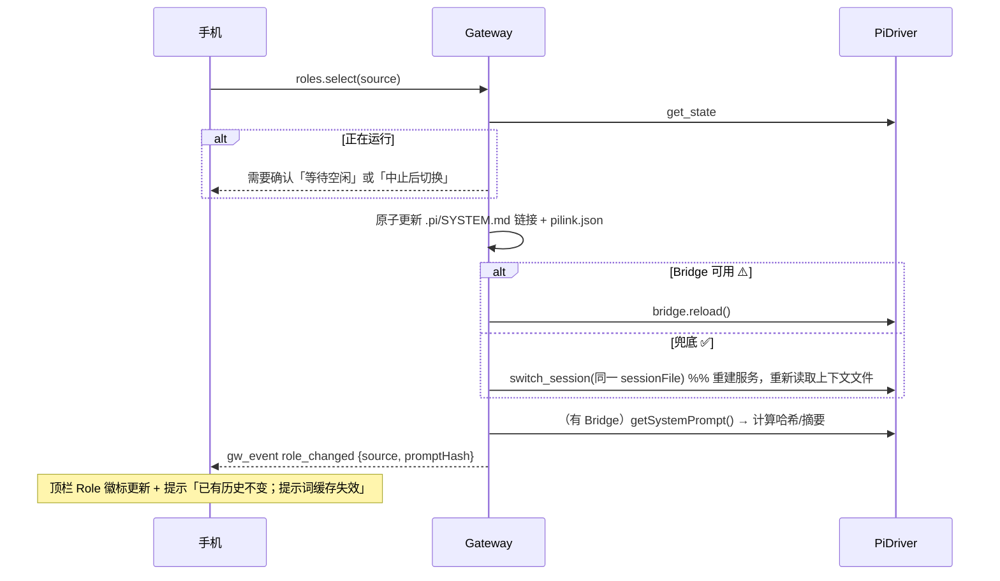
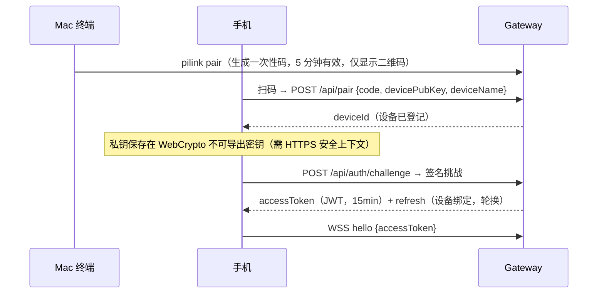

# PiLink 设计文档

> 版本：v0.2（草案，已纳入第一轮确认结论：北京 ECS + 仅 IP、终端直接运行 pi、多设备、不迁移飞书历史）　配套：《PiLink-01-需求文档.md》
> 标记：✅ 已对照 Pi 官方文档核对　⚠️ 需 Spike 验证后定稿

---

## 1. 设计概览

### 1.1 一句话架构

> Mac 上跑一个 **Gateway**（TypeScript），它通过 **Host 模式**（拉起 `pi --mode rpc`）或 **Attach 模式**（经 **Bridge 扩展**接入本机 TUI 里的 Pi）持有 Pi 会话；手机上的 **PWA** 通过 WebSocket 与 Gateway 通信；公网访问由 **frpc → 阿里云 frps → Nginx(TLS)** 提供。

### 1.2 关键设计决策（ADR 摘要）

| # | 决策 | 理由 | 备选/代价 |
|---|---|---|---|
| D1 | Agent 层 **完全复用 Pi**，PiLink 只做「远程 + 移动 UI」 | 避免重造 Agent；Pi 升级自动受益 | 受限于 Pi 暴露的接口 |
| D2 | Host 模式使用 **RPC 子进程**，而非 SDK 内嵌 | ✅ SDK 会话默认不加载 CLI 内置的 codemode/tool_search/MCP 扩展，RPC 子进程与 CLI 行为一致；进程隔离，Pi 崩溃不拖垮 Gateway | 无法直接读 `session.systemPrompt`（用 Bridge 补） |
| D3 | 会话共享的**真相源 = Pi 的 Session JSONL 文件** + **单写者租约（lease）** | ✅ 会话是追加写的树，条目 id 稳定；单写者可避免上下文分叉 | 需要交接流程 |
| D4 | 引入 **Bridge 扩展**，同时用于 Attach（本机 TUI）与 Host（`-e` 加载） | 一套扩展，两种场景；补齐 RPC 缺失能力（reload、系统提示词读取、树导航等）⚠️ | 依赖扩展 API，需 Spike |
| D5 | **内置斜杠命令由客户端/Gateway 自己实现**，动态命令取自 `get_commands` | ✅ 内置命令不经 RPC | 随 Pi 版本维护命令表（契约测试兜底） |
| D6 | Role 选择 = **受管的 `.pi/SYSTEM.md` 符号链接** + reload | 与 Pi 原生机制一致，本机终端同样生效；不改 Pi | 需处理已有文件、信任门槛 |
| D7 | 客户端为 **React PWA**；同一份前端本机/手机通用 | 纯 TS、迭代快、免 App Store | iOS PWA 限制（推送需 ≥16.4、后台受限） |
| D8 | 网络：Gateway 仅监听 127.0.0.1，frps 代理端口仅绑 ECS 回环，**由 Nginx 在「公网 IP + 非标准端口」上做 TLS 终结** | 最小暴露面；证书与限流在成熟组件里做 | 多一跳 |
| D10 | **无域名 ⇒ 使用 Let's Encrypt IP 证书**（约 6 天有效，自动续期）；备选私有 CA | 浏览器需要「安全上下文」才能启用 PWA/Service Worker/WebCrypto/Web Push；IP 证书无需域名与备案 | 续期频繁，需监控；北京 ECS 的 ACME 验证需 Spike 确认 |
| D11 | 认证用 **WebCrypto 设备密钥**，不用 Passkey | WebAuthn 的 RP ID 不能是 IP 地址 | 需自实现挑战-签名流程（见 §11.4） |
| D12 | **多设备为一等公民**：订阅/广播天然多端，写操作串行 | 需求 SYNC-8 | 需做在线状态与输入提示 |
| D9 | 协议：WebSocket 上的 **JSON 信封**，Pi RPC 命令/事件**透传** + Gateway 自有操作 | 复用 Pi 类型；前端行为贴近 TUI | 需对透传做白名单与鉴权 |

---

## 2. 总体架构



**部署单元**

| 单元 | 位置 | 说明 |
|---|---|---|
| `pilink-gateway` | Mac | Node 服务，launchd 常驻 |
| `pilink-bridge` | Pi 扩展包 | 安装到 `~/.pi/agent/extensions/`（或作为 Pi package），本机 TUI 自动加载 |
| `pilink-web` | 由 Gateway 静态托管 | PWA 产物 |
| `frpc` | Mac | launchd 常驻，出站连接 ECS |
| `frps` + Nginx | ECS | 公网入口 |

---

## 3. Pi 集成层：Driver 抽象

Gateway 通过统一的 `PiDriver` 接口屏蔽「谁持有会话」的差异。

```ts
// packages/gateway/src/driver/types.ts
import type { RpcCommand, RpcResponse, PiEvent } from "@pilink/protocol";

export type DriverKind = "host" | "attach";

export interface PiDriver {
  readonly kind: DriverKind;
  readonly workspaceId: string;
  /** 发送 Pi RPC 命令（Attach 模式下由 Bridge 翻译为扩展 API 调用） */
  request(cmd: RpcCommand, signal?: AbortSignal): Promise<RpcResponse>;
  /** 订阅 Pi 事件（message_update / tool_execution_* / agent_settled …） */
  onEvent(fn: (ev: PiEvent) => void): () => void;
  /** 额外能力：Bridge 提供，可能缺失 */
  readonly caps: DriverCaps;
  /** 释放：Host=关闭 stdin 优雅退出；Attach=断开 Bridge（不影响 TUI 进程） */
  release(): Promise<void>;
}

export interface DriverCaps {
  reload: boolean;          // ⚠️ Bridge: 触发等价 /reload
  getSystemPrompt: boolean; // ⚠️ Bridge: 读取当前生效系统提示词
  navigateTree: boolean;    // ⚠️ Bridge: 切换会话树叶子
  liveCoPresence: boolean;  // Attach: 与本机 TUI 实时共视
}
```

### 3.1 HostDriver（M1，✅ 全部基于已核实的 RPC）

- 启动：`pi --mode rpc --session <file>`（cwd = workspace；额外 `-e <bridge>` 加载 Bridge；具体 flag 以 `pi --help` 为准）。
- 分帧：**自写 LF 分帧器**，不使用 `readline`（✅ 官方明确指出其会按 U+2028/2029 误切）。
- 命令关联：每个命令带唯一 `id`；Pi 的响应按 `id` 回填；事件无 `id`，直接广播。
- 背压：持续读 stdout；写 stdin 时尊重 backpressure（✅ 官方要求）。
- 生命周期：关闭 stdin 即请求优雅退出；监控非预期退出并自动按需重启/标记为「空闲」。
- `prompt` 响应只表示「已接收/排队/已处理」（`disposition: started | queued | handled`），**完成态以 `agent_settled` 为准**（✅），UI 的「运行中」状态由事件驱动，而不是命令响应。

### 3.2 AttachDriver（M3，⚠️）

本机终端里已有一个交互式 Pi（TUI）。Bridge 扩展随 Pi 启动加载，主动连接 Gateway（`ws://127.0.0.1:7789/bridge`，仅回环），并：

1. **上行**：订阅 Pi 扩展事件（消息更新、工具执行、compaction、队列变化…）原样转发 → 手机实时共视；
2. **下行**：把手机的 `prompt/steer/follow_up/abort`、模型/思考等级切换、compact、fork 等，翻译为扩展 API 调用；用户消息出现在本机 TUI 中；
3. **补缺**：提供 `reload`、读取系统提示词、树导航等 RPC 没有的能力。

> **Spike 清单（M0）**：扩展 API 是否支持 ① 从扩展内以「用户消息」注入并区分 steer/followUp；② 订阅与 RPC 等价的完整事件（含 `thinking_delta`）；③ 在命令上下文中触发 `reload` / `newSession` / `fork` / `switchSession` / `compact` / 树导航；④ 读取当前系统提示词；⑤ 项目信任状态查询。若 ①②不满足，则 Attach 退化为「只读共视 + 交接」，仍满足 SYNC-1/2/3。

> **确认：日常在终端直接运行 `pi`，不使用 tmux。** 因此不存在「向终端注入按键」的捷径，Attach **只能依赖 Bridge 扩展**。Bridge 随 Pi 自动加载，用户无需改变使用习惯；交接话术见 §4.3。若 S1/S2 不通过，则始终走「交接式」：在终端 `/quit`（或 Bridge 提供的 handoff 命令）→ 手机托管 → 回到电脑 `pi --session <path>` 接回。

### 3.3 Driver 选择规则



---

## 4. 会话共享与交接（对应 SYNC）

### 4.1 为什么必须有「单写者」

Pi 会话是追加写的 JSONL 树，每条记录带 `id/parentId`。两个进程各自在内存里持有上下文并都往同一文件追加，不会损坏文件，但会在同一父节点下**分叉**，且两边的内存上下文互相过期。因此要保证 **同一时刻只有一个 Pi 进程持有某个会话**。

### 4.2 租约（lease）

- 位置：`<session>.jsonl` 同目录的 `<session>.pilink.lock`（JSON：`holder: "host"|"tui"`、`pid`、`startedAt`、`heartbeatAt`、`gatewayId`）。
- Host 获取 lease 后每 5s 刷新心跳；> 20s 无心跳视为陈旧，可被抢占（并校验 `pid` 是否存活）。
- **Bridge 在本机 TUI 启动/切换会话时**检查 lease：
  - 无锁 → 登记 `holder: "tui"` 并向 Gateway 注册；
  - 锁属于 Host → 在 TUI 里用 `ctx.ui.confirm` 提示「手机端正在托管此会话，是否接管？」，同意则请求 Gateway `release`，等待其优雅退出后继续（Pi 随后从文件加载最新历史）。
- 兜底（没装 Bridge 的终端）：Host 在托管期间 `fs.watch` 会话文件，发现**非自身写入**（大小/mtime 变化且无对应事件）→ 标记 `conflict`，暂停接收新 prompt，提示用户选择「以磁盘为准重载」（`switch_session` 同一文件）或「放弃本机变更」。

### 4.3 交接时序



M3 之后（Attach）无需「关闭再开启」：手机直接挂接在本机 TUI 进程上，两端同时在线。

### 4.4 重连与增量补齐（SYNC-6）

- Gateway 为每个会话维护单调递增的 `seq` 和一个**环形缓冲**（默认最近 5,000 个事件或 10MB）。
- 客户端重连携带 `lastSeq`：缓冲命中 → 补发缺失事件；未命中（Gateway 重启/超出缓冲）→ 退化为 `get_entries { since: lastEntryId }`（✅ 条目 id 是持久游标，跨重启有效）并用 `get_state` 校准运行状态。
- 渲染以**条目 id / 消息 id 幂等去重**，避免重复。

---

## 5. 协议设计（Client ⇄ Gateway）

### 5.1 信封

```ts
// packages/protocol/src/wire.ts
export type SessionKey = `${string}:${string}`; // `${workspaceId}:${sessionId}`

/** Client → Gateway */
export type ClientMsg =
  | { t: "hello"; v: 1; deviceId: string; accessToken: string;
      resume?: { sessionKey: SessionKey; lastSeq: number; lastEntryId?: string } }
  | { t: "rpc"; id: string; sessionKey: SessionKey; cmd: RpcCommand }      // 透传 Pi RPC
  | { t: "gw"; id: string; op: GatewayOp }                                 // Gateway 自有操作
  | { t: "ui_response"; sessionKey: SessionKey; requestId: string; payload: unknown } // 扩展 UI 回传
  | { t: "ping"; ts: number };

/** Gateway → Client */
export type ServerMsg =
  | { t: "hello_ok"; serverVersion: string; piVersion: string; features: string[] }
  | { t: "rpc_res"; id: string; res: RpcResponse }
  | { t: "event"; sessionKey: SessionKey; seq: number; ev: PiEvent }       // Pi 事件
  | { t: "gw_res"; id: string; ok: true; data: unknown }
  | { t: "gw_res"; id: string; ok: false; error: { code: string; message: string } }
  | { t: "gw_event"; ev: GatewayEvent }                                    // 持有者变化、Role 变化、冲突…
  | { t: "ui_request"; sessionKey: SessionKey; requestId: string; payload: unknown }
  | { t: "pong"; ts: number };
```

`RpcCommand / RpcResponse / PiEvent` **直接复用/再导出 Pi 的 `rpc-types.ts`**（✅ Pi 导出了协议类型），避免手抄漂移；`@pilink/protocol` 额外用 zod 对入站消息做**运行时校验**。

### 5.2 Gateway 自有操作

```ts
export type GatewayOp =
  | { op: "workspaces.list" }
  | { op: "sessions.list"; workspaceId: string; query?: string }
  | { op: "session.open"; workspaceId: string; sessionPath: string; mode?: "auto" | "host" }
  | { op: "session.release"; sessionKey: SessionKey }
  | { op: "session.takeover"; sessionKey: SessionKey }
  | { op: "commands.list"; sessionKey: SessionKey }            // 内置表 ∪ get_commands
  | { op: "roles.list"; workspaceId: string }
  | { op: "roles.select"; workspaceId: string; source: string | null } // null = Pi 默认
  | { op: "roles.preview"; workspaceId: string; source: string }
  | { op: "fs.search"; workspaceId: string; query: string; limit?: number }   // @ 文件引用
  | { op: "settings.get" } | { op: "settings.patch"; patch: Record<string, unknown> }
  | { op: "export.download"; sessionKey: SessionKey }
  | { op: "host.keepAwake"; enabled: boolean }
  | { op: "devices.list" } | { op: "devices.revoke"; deviceId: string };

export type GatewayEvent =
  | { e: "holder_changed"; sessionKey: SessionKey; holder: "tui" | "host" | "none" }
  | { e: "role_changed"; workspaceId: string; source: string | null; promptHash?: string }
  | { e: "conflict"; sessionKey: SessionKey; reason: "external_write" | "lease_lost" }
  | { e: "host_status"; sessionKey: SessionKey; status: "starting" | "ready" | "exited"; code?: number }
  | { e: "presence"; sessionKey: SessionKey; devices: { deviceId: string; name: string; typing: boolean; lastSeen: number }[] }
  | { e: "cert_expiring"; hoursLeft: number };
```

### 5.3 透传白名单

Gateway 对 `rpc` 消息只放行预定义命令集合（✅ 即需求文档 §7 第 2 条所列）；对 `bash` 额外检查工作区白名单与审计；任何未知 `type` 一律拒绝。

---

## 6. 命令系统（对应 CMD）

### 6.1 注册表

```ts
// packages/web/src/commands/registry.ts
export type CommandSource = "builtin" | "extension" | "prompt" | "skill";
export type Availability = "full" | "degraded" | "local-only";

export interface SlashCommand {
  name: string;                 // 不含 "/"，skill 形如 "skill:review"
  description?: string;
  source: CommandSource;
  argHint?: string;             // 例如 "[provider/model]"
  availability: Availability;
  /** 内置命令：移动端原生交互；动态命令：构造 `/name args` 走 prompt */
  run(ctx: CommandContext, args: string): Promise<void>;
}
```

- **内置命令表**随客户端发布（依据 ✅ Slash commands 文档），每项绑定到 RPC 调用或移动端界面（见需求附录 A）。
- **动态命令** = `get_commands` 返回的 `extension / prompt / skill`（✅），`run` 统一为 `prompt("/" + name + " " + args)`。
- **合并**：同名时「扩展 > 内置」按 Pi 实际行为为准（⚠️ Spike 核对优先级）；列表在 `session_open` 与每次 reload 后刷新。
- **契约测试**：CI 里跑 `pi --help` 与（可选）解析 Pi 文档中的命令表，若出现客户端未登记的新内置命令则报警。

### 6.2 命令面板交互

- 触发：输入框以 `/` 开头（或点击 `/` 快捷键）。
- 形态：底部抽屉，高度随软键盘自适应（`visualViewport`）；顶部搜索随输入过滤，**分组**：最近 / 内置 / 扩展 / 模板 / 技能。
- 排序：前缀匹配 > 子串匹配 > 模糊匹配；同分按最近使用频次。
- 选择后：无参命令直接执行；有参命令把 `/name ` 填入输入框并显示参数提示 chip；需要选择的命令（如 `/model`）打开对应原生选择器。

### 6.3 需要 Bridge 才能完整的命令（⚠️）

| 命令 | 无 Bridge 的降级 | 有 Bridge |
|---|---|---|
| `/reload` | `switch_session` 到同一文件（✅ 会话切换会重建服务）；需在空闲时执行 | 直接 reload，保留运行态 |
| `/tree` 导航 | 只读树 + 从节点 `fork` | 切换活动叶子 |
| `/trust` | 提示「请在本机 `pi` 中执行一次 `/trust`」 | 触发信任流程 |
| `/import` | Gateway 复制文件到会话目录 + `switch_session` | 同左 |

---

## 7. 流式、Thinking 与工具渲染（对应 RND）

### 7.1 事件到 UI 的映射

| Pi 事件 | UI 行为 |
|---|---|
| `message_update` · `thinking_*`（✅ 第三方适配器文档可见 `thinking_delta`；⚠️ 以官方 JSON 事件流页为准） | 追加到「思考」折叠块；折叠态显示最后一行实时预览与计时 |
| `message_update` · `text_delta` | 追加到助手文本，增量 Markdown 渲染 |
| `message_update` · 工具调用相关 | 创建/更新工具卡片（参数流式补全） |
| `tool_execution_start/update/end` | 卡片状态：运行 → 成功/失败；输出流式追加 |
| `message_end` | **以其为权威**，用完整消息覆盖增量拼装结果（✅ SDK 文档：`message_end` 含权威完成消息） |
| `agent_end` | 一次 run 结束，但**不代表空闲** |
| `agent_settled` | 空闲：解锁输入、发送本地推送（✅） |
| `auto_compaction_*` / 重试事件 | 顶部状态条 |
| 队列变化 | 输入框上方显示待发 steer / follow-up 胶囊，可撤销 |

### 7.2 渲染管线（性能）

1. 事件进入 store（Zustand），按 `rAF` 批量合并（每帧最多一次 UI 提交）。
2. Markdown 增量解析：只重解析「最后一个未闭合块」；已完成块缓存为 React 节点。
3. 代码高亮（shiki）按语言**懒加载**并放入 Web Worker；流式阶段先用纯文本，块闭合后再高亮。
4. 消息列表用 TanStack Virtual 虚拟化；工具输出超过阈值（如 20KB）仅展示尾部，展开时经 Gateway 按需拉取全文（✅ `bash` 截断时有 `fullOutputPath`）。
5. 吸底滚动：仅当用户在底部时自动跟随；用户上滑后显示「回到底部」悬浮按钮。

### 7.3 Thinking 展示策略

- 三档：**展开 / 折叠（默认）/ 隐藏**，可全局或按会话设置（对历史消息同样生效）。
- 历史消息的 thinking 块来自 `get_messages` / `get_entries`（✅ `AgentMessage` 内容块）；若 provider 未返回可读内容（加密/摘要），显示「思考内容不可见」+ 用时。
- 思考文本按纯文本/轻 Markdown 渲染，字体与颜色弱化，避免与正文混淆。

---

## 8. Role（SYSTEM.md）选择器（对应 ROLE）

### 8.1 原理

Pi 只在固定位置读取系统提示词覆盖（✅）：`<cwd>/.pi/SYSTEM.md`（项目，需信任）优先于 `~/.pi/agent/SYSTEM.md`（全局）。PiLink 不改 Pi，只**管理 `.pi/SYSTEM.md`**，使其指向用户选中的文件。

### 8.2 候选发现

- 扫描 Workspace（深度 ≤ 4，忽略 `node_modules/.git/dist/build` 与 `.gitignore`）：
  - 任意目录下的 `SYSTEM.md`；
  - `.pi/roles/*.md`（推荐的集中存放处）；
  - 用户手动「固定」的绝对/相对路径。
- 每个候选展示：相对路径、标题（首个 `#` 标题或首行）、前 3 行预览、大小、修改时间、是否为当前生效项。
- 额外一项：**Pi 默认**（见 8.4）。

### 8.3 受管链接与状态

```
<workspace>/.pi/SYSTEM.md        → 符号链接，指向所选文件（PiLink 管理）
<workspace>/.pi/pilink.json       { "role": { "source": "my-agent/SYSTEM.md", "managed": true,
                                              "backup": ".pi/roles/_original.SYSTEM.md" } }
```

- 选择候选 X：
  1. 若 `.pi/SYSTEM.md` 存在且**不是**受管链接 → 弹窗「纳入管理？」；确认后**移动**到 `.pi/roles/_original.SYSTEM.md`（成为候选项）并记录（ROLE-5，保证不丢内容）；
  2. 原子替换：先创建临时链接再 `rename`，避免读到半成品；
  3. 触发 reload（§8.5）。
- 选择「Pi 默认」：删除受管链接（若有备份且用户要求还原则恢复），触发 reload。
- 选择的是链接而非拷贝：用户在编辑器里改了源文件，手机上点「重新加载」即可生效。
- 注意：若所选文件本身就在 `.pi/SYSTEM.md`（即原生文件），列表中标注「原生」，不做链接。

### 8.4 「默认」的精确含义



即「默认」= 不施加项目级覆盖；若用户另有全局覆盖，UI 如实告知（避免「以为是默认其实是全局角色」）。

### 8.5 自动 reload 流程



- **信任校验（ROLE-7 ⚠️）**：项目 SYSTEM.md 受项目信任约束。reload 后若能读取系统提示词（Bridge），对比是否包含所选文件首段；不一致 → 判定「未生效」，提示去信任（`/trust`）。无 Bridge 时在 UI 标注「无法确认已生效」并提供「发送测试提问」的可选校验。
- **失败回滚**：reload/switch 失败 → 恢复上一个链接状态与 `pilink.json`。
- **作用域**：Role 是**工作区级**状态（落在文件系统），与会话无关；在顶栏 Role 徽标显示，点击即打开选择器。

---

## 9. 移动端 UI 设计

### 9.1 信息架构

```
底部导航：对话 | 会话 | 工作区 | 设置
对话页：
 ┌ 顶栏：工作区 · Role 徽标 · 持有者状态 · 模型 · 思考等级 · 上下文占用环 ┐
 │ 消息流（thinking 折叠块 / 助手文本 / 工具卡片 / 状态条）              │
 │ 待发队列胶囊（steer / follow-up）                                       │
 │ 快捷栏：[中止][模型][思考][压缩][树][新会话][附件]                       │
 └ 输入区：多行 · 「/」命令 · 「@」文件 · 「!」bash · 发送(长按选 steer/follow-up) ┘
```

### 9.2 输入优化清单

| 点 | 做法 |
|---|---|
| 回车行为 | 手机默认**换行**，显式发送键；外接键盘检测到时切为 Enter 发送 / Shift+Enter 换行 |
| 键盘遮挡 | `visualViewport` 监听，抽屉与输入区随键盘高度调整；`interactive-widget=resizes-content` |
| 草稿 | 每个会话独立草稿，IndexedDB 持久化 |
| 触发符 | `/`、`@`、`!` 在行首/空格后触发对应面板；面板内可点选，无需精确打字 |
| 运行中发送 | 长按发送键 → Steer / Follow-up；队列可见可撤销 |
| 中止 | 固定位置的醒目按钮；先 `clear_queue` 再 `abort` 并回填输入框（✅ 官方推荐的 Esc 行为） |
| 触觉与反馈 | 关键操作 haptics；发送后立即本地回显（乐观 UI），以 `message_end` 对账 |
| 单手 | 所有主操作位于下半屏；抽屉优先于全屏页 |

### 9.3 需要用户确认的危险操作

`/new`（运行中）、`abort`、`roles.select`（运行中）、`session.takeover`、`/share`、`bash` 在受限工作区之外 —— 统一使用确认抽屉，文案说明后果。

### 9.4 PWA 要点

- `manifest.webmanifest`、`display: standalone`、`safe-area-inset-*`、深浅色主题；
- Service Worker（Workbox）缓存静态资源；**不缓存**会话数据与 API；
- Web Push（VAPID，由 Gateway 发送）：`agent_settled`、需要确认的扩展 UI、连接异常；iOS 需「添加到主屏」后才可用（≥16.4）；
- 前台/后台：页面恢复可见时立即重连并走 §4.4 的增量补齐。

---

## 10. Gateway 设计

### 10.1 模块

```
packages/gateway/src
├─ server.ts            Fastify：静态资源、/api/auth、/ws（WebSocket）
├─ auth/                配对、WebCrypto 设备密钥、JWT、吊销、速率限制、审计
├─ ws/hub.ts            连接管理、广播、seq 与环形缓冲、ui_request 路由
├─ workspace/           白名单、会话列表（解析 JSONL 头）、fs.search、最近使用
├─ driver/
│   ├─ host.ts          RPC 子进程：LF 分帧、id 关联、背压、重启
│   ├─ attach.ts        Bridge WS 通道（127.0.0.1:7789）
│   └─ lease.ts         租约文件、心跳、冲突监测（fs.watch）
├─ role/                候选发现、受管链接、pilink.json、reload 编排
├─ commands/            内置命令表（服务端侧实现项：import/settings/export…）
├─ push/                Web Push（VAPID）
└─ system/              keep-awake（caffeinate）、launchd 辅助、doctor
```

### 10.2 持久化

- Gateway 自身状态（设备、JWT 吊销表、推送订阅、最近工作区、审计日志）：`~/.pilink/`，使用 SQLite（better-sqlite3）。
- **不复制** Pi 的会话数据；一律读 Pi 的 JSONL / 经 RPC 获取（避免双份真相）。
- 严禁读取并下发 `~/.pi/agent/auth.json`、`models.json` 中的密钥字段；`settings.patch` 只允许白名单字段。

### 10.3 并发与多设备

- **所有设备同时订阅**同一会话（SYNC-8）：Hub 对每个 `sessionKey` 维护订阅者集合，事件按 `seq` 广播给全部在线设备；各设备各自维护 `lastSeq`，重连独立补齐。
- **写操作**（prompt/steer/follow_up/abort/…）经 Hub 串行进入 Driver，沿用 Pi 自身的队列语义；每条写操作记录来源 `deviceId`，用于 UI 标注「来自 iPad」。
- **在线状态（presence）**：`gw_event: presence {sessionKey, devices:[{deviceId,name,typing,lastSeen}]}`，输入框聚焦/输入时每 3s 上报一次 `typing`；不做互斥锁。
- **乐观 UI 对账**：本机发送的消息先本地回显，收到 `message_end`/条目 id 后用权威消息替换；他端发送的消息直接来自事件。
- **通知**：`agent_settled` 等推送发往所有已授权设备；任一设备在前台且正在查看该会话时，抑制其它设备的重复推送（可配置）。
- **会话打开/Host 启动**：只由首个请求触发，其它设备复用同一 Driver，避免重复拉起 `pi`。

### 10.4 错误模型

统一错误码：`AUTH_*`、`LEASE_CONFLICT`、`HOST_EXITED`、`BRIDGE_UNAVAILABLE`、`ROLE_UNTRUSTED`、`ROLE_RELOAD_FAILED`、`RPC_REJECTED`（Pi 返回 `success:false`，原文透传）、`PI_VERSION_UNSUPPORTED`。客户端按码给出可操作的提示。

---

## 11. 远程访问与安全（frp + 阿里云）

### 11.1 拓扑与端口（北京 ECS，仅 IP，无域名）

| 位置 | 组件 | 监听 | 对外 |
|---|---|---|---|
| Mac | Gateway | `127.0.0.1:7788` | 否 |
| Mac | Bridge 通道 | `127.0.0.1:7789` | 否 |
| Mac | frpc | 出站连接 ECS:7000 | — |
| ECS | frps | `:7000`（控制连接，TLS+token）；代理端口仅绑 `127.0.0.1` | 7000 仅供 frpc |
| ECS | Nginx | `:8443`（HTTPS/WSS，**IP 证书**） | **是**（唯一业务入口） |
| ECS | ACME 验证 | `:80`（HTTP-01）或 `:443`（TLS-ALPN-01），**仅签发/续期时临时开放** | 临时 |

端口选择：**避开 80 / 443 / 8080 作为业务端口**——阿里云对中国大陆节点未备案站点有这几个端口的拦截策略（⚠️ 以阿里云当前规则为准，Spike S11 验证）。使用 `8443` 之类的高位端口。

安全组：开放 `8443`（业务）、`7000`（frps 控制连接，家庭宽带 IP 变动时无法固定来源，靠 TLS + token 保护）；`80` 按需临时开放。**不要开放 frps 代理端口与 dashboard。**

访问地址：`https://<ECS 公网 IP>:8443`。

### 11.1.1 IP 证书（D10）

- 使用支持 `shortlived` 证书 profile 的 ACME 客户端（Let's Encrypt 自 2026 年起正式提供 IP 地址证书，IPv4/IPv6 均可，必须是 short-lived，约 160 小时有效；验证方式为 HTTP-01 或 TLS-ALPN-01）。具体命令与参数以所用客户端（如 Certbot）的官方文档为准。
- 续期：定时任务每日检查，剩余有效期 < 48h 开始每小时重试；成功后 `nginx -s reload`。
- 监控：Gateway 通过 frp 隧道无法感知证书状态，因此在 ECS 上放一个轻量检查脚本，续期失败时通过 Gateway 的 Web Push/本机通知告警（Mac 在线时）。
- **备选（Spike 失败或证书不可用时）**：
  1. 私有 CA：本机生成根证书，签发含 IP SAN 的服务证书；手机/平板安装并信任根证书（iOS：安装描述文件后还需在「证书信任设置」中启用完全信任；Android 需用户安装 CA，部分系统对用户 CA 有限制）。可用但体验差，且根 CA 私钥必须妥善保管。
  2. 私网组网（Tailscale/WireGuard）：不需要公网入口与证书，作为 frp 的替代。
- 为什么不能「先用 HTTP 凑合」：非 HTTPS 页面不是安全上下文，Service Worker、PWA 安装、`crypto.subtle`（设备密钥）、Web Push 都不可用，且明文传输会暴露所有会话内容与令牌。

### 11.2 frp 配置示例（TOML；字段请按所用 frp 版本核对 ⚠️）

`frps.toml`（ECS）：

```toml
bindPort = 7000
proxyBindAddr = "127.0.0.1"        # 代理端口只在回环监听，公网只能经 Nginx 进入

auth.method = "token"
auth.token = "<长随机字符串，与 frpc 一致>"

transport.tls.force = true         # 强制 TLS

allowPorts = [{ single = 17788 }]  # 只允许 frpc 使用指定端口
```

`frpc.toml`（Mac）：

```toml
serverAddr = "<ECS 公网 IP>"
serverPort = 7000

auth.method = "token"
auth.token = "<与 frps 相同>"

transport.tls.enable = true
loginFailExit = false              # 网络波动时持续重试

[[proxies]]
name = "pilink-gateway"
type = "tcp"
localIP = "127.0.0.1"
localPort = 7788
remotePort = 17788
```

Nginx（ECS，IP 证书 + WebSocket；无 `server_name`，以 IP 访问）：

```nginx
# http{} 层
limit_req_zone $binary_remote_addr zone=pilink:10m rate=20r/s;

server {
  listen 8443 ssl http2 default_server;
  ssl_certificate     /etc/pilink/certs/ip/fullchain.pem;   # IP 证书
  ssl_certificate_key /etc/pilink/certs/ip/privkey.pem;
  add_header Strict-Transport-Security "max-age=86400" always;

  location / {
    limit_req zone=pilink burst=40 nodelay;
    proxy_pass http://127.0.0.1:17788;
    proxy_http_version 1.1;
    proxy_set_header Upgrade $http_upgrade;
    proxy_set_header Connection "upgrade";
    proxy_set_header Host $host;
    proxy_set_header X-Forwarded-For $remote_addr;
    proxy_read_timeout 3600s;
    proxy_send_timeout 3600s;
  }
}
```

> HSTS 的 `max-age` 在 IP 证书方案下刻意设短（1 天），避免证书续期故障时浏览器长时间无法回退。

### 11.3 Mac 侧常驻

- `launchd` LaunchAgent：`com.pilink.gateway`、`com.pilink.frpc`，`KeepAlive=true`、`RunAtLoad=true`。
- 保持唤醒：Gateway 提供开关，内部以 `caffeinate -i`（或 `-s`，接电源时）绑定自身 PID；合盖运行需满足 macOS 的外接电源/外显等条件，文档中明确说明，`pilink doctor` 检查。
- WebSocket 心跳 25s（应用层 ping/pong），避免移动网络与代理的空闲断开。

### 11.4 认证与授权



- **设备密钥**：浏览器生成 **不可导出**的 ECDSA P-256 密钥（WebCrypto，存 IndexedDB），配对时上传公钥；登录用「服务端挑战 → 设备签名」。**不使用 WebAuthn/Passkey**（RP ID 不能是 IP，D11）。泄露单个 token 不足以接管；refresh 令牌轮换且与设备绑定；任一设备可被吊销。
- **多设备**：每台设备独立密钥与令牌；设备上限可配置（默认 5）；设备列表展示名称、最近在线、来源 IP，可单独吊销。
- 可选二次验证（TOTP）用于高风险操作（例如 `session.takeover`、`/share`、白名单外 `bash`）。
- 所有 `rpc` 与 `gw` 消息经授权中间件：设备有效、工作区在白名单内、命令在放行集合内；全部写入审计日志（时间、设备、工作区、命令类型，**不记录完整提示词与输出**）。
- 浏览器侧：严格 CSP、`SameSite=Strict` Cookie（如使用）、WebSocket `Origin` 校验。

### 11.5 威胁与对策

| 威胁 | 对策 |
|---|---|
| 公网暴露导致任意命令执行（仅 IP 入口更易被扫描） | 强认证 + 设备配对 + 白名单工作区 + 限流 + 审计；默认不开放 `bash` 到白名单外 |
| 令牌泄露 | 短期 JWT、设备绑定、轮换 refresh、吊销 |
| 中间人 | frp TLS + token；Nginx TLS；HSTS |
| 暴力破解 | 配对码一次性 + 短有效期；失败锁定；Nginx 限流 |
| 日志泄密 | 脱敏；不记录提示词/输出正文 |
| Mac 被误用于跳板 | Gateway 仅监听回环；Bridge 通道仅回环；frps 代理端口仅绑回环 |
| 供应链 | 锁定依赖版本；`npm ci`；定期审计 |

> 备选网络方案（不在 v1 范围）：Tailscale/WireGuard 等私网组网，可省去公网入口、证书与备案问题；若 Spike S11 失败，将提升为首选方案。

---

## 12. 仓库结构与技术栈

```
pilink/
├─ packages/
│  ├─ protocol/     # 共享类型 + zod 校验（再导出 Pi rpc-types）
│  ├─ gateway/      # Node 服务（Fastify, ws, better-sqlite3）
│  ├─ bridge/       # Pi 扩展（TypeScript），可作为 Pi package 发布
│  ├─ web/          # React + Vite PWA
│  └─ cli/          # `pilink` 命令：start / pair / release / doctor / install-launchd
├─ deploy/
│  ├─ frp/          # frps.toml / frpc.toml 模板
│  ├─ nginx/        # 站点模板
│  └─ launchd/      # plist 模板
├─ docs/            # 需求/设计/运维手册
└─ pnpm-workspace.yaml
```

| 层 | 选型 |
|---|---|
| 语言/构建 | TypeScript（strict）、pnpm workspaces、tsup（Node 包）、Vite（Web） |
| Gateway | Node（版本与 Pi 要求一致）、Fastify、`ws`、zod、better-sqlite3、`web-push` |
| Pi 集成 | `@earendil-works/pi-coding-agent`（类型与 RpcClient 参考）、自写 LF 分帧 |
| Web | React 18、Zustand、TanStack Virtual、Tailwind、vite-plugin-pwa、shiki（懒加载）、markdown 增量渲染 |
| 测试 | Vitest（单测）、Playwright（含移动端视口 E2E）、基于 mock-pi（回放 JSONL 的假 Pi）的集成测试 |
| 质量 | ESLint、Prettier、changesets、CI 契约测试（Pi 版本矩阵） |

> 包名注意：Pi 的 npm 包已迁移为 `@earendil-works/pi-coding-agent`，旧名 `@mariozechner/pi-coding-agent` 已弃用 ✅。

---

## 13. 可靠性与异常处理

| 场景 | 行为 |
|---|---|
| 手机断网/锁屏 | 指数退避重连（0.5s→8s 上限，带抖动）；恢复后 §4.4 补齐 |
| Gateway 重启 | 启动时扫描 lease：陈旧的清理；仍存活的 Host 子进程（若采用独立守护）可重新附着；否则标记会话为空闲，客户端提示「重新托管」 |
| Pi 子进程崩溃 | 标记 `HOST_EXITED`；保留已落盘会话；用户一键重新托管，从文件恢复 |
| Provider 错误/重试 | 事件原样展示；`abort_retry` 提供中止重试按钮 |
| 租约冲突 | 展示持有者与时间，提供「只读观看 / 请求接管」 |
| Pi 版本不兼容 | `hello_ok` 带 `piVersion`；不在支持范围时降级为只读并提示升级 |
| 长任务期间 Mac 休眠 | UI 显示「主机离线」；唤醒后自动恢复；推送提醒 |

---

## 14. 测试策略

1. **契约测试**：针对 Pi 版本矩阵跑 `get_commands / get_state / get_entries / prompt` 冒烟，检测协议漂移。
2. **mock-pi**：按录制的 JSONL 事件序列回放，覆盖 thinking/工具/compaction/重试等渲染路径，不消耗真实模型费用。
3. **租约与冲突**：模拟双写、陈旧锁、进程崩溃。
4. **Role**：已有 `.pi/SYSTEM.md`、符号链接、未信任项目、运行中切换、失败回滚。
5. **E2E（Playwright 移动视口）**：命令面板、软键盘、断线重连、steer/follow-up、中止回填。
6. **安全测试**：未配对访问、令牌过期/吊销、越权工作区、超大消息、速率限制。
7. **性能**：长流式输出下的帧率与内存；10 万字符消息列表滚动。

---

## 15. 里程碑与 Spike 清单

### 15.1 里程碑（与需求文档一致）

| 阶段 | 交付 |
|---|---|
| M0 | Spike 报告（见下） |
| M1 | Host 模式 + Web 客户端（流式 / thinking / 工具卡片 / 命令面板 / 会话列表 / 交接 / 本地访问） |
| M2 | Role 选择器 + frp/HTTPS + 设备配对认证 + PWA/推送 |
| M3 | Bridge + Attach 实时共享 |
| M4 | P1/P2 命令、手势、弱网与性能打磨、`pilink doctor` |

### 15.2 M0 Spike 清单

| # | 验证项 | 通过标准 | 失败预案 |
|---|---|---|---|
| S1 | Bridge：扩展内能否订阅完整事件（含 thinking）并转发 | 与 RPC 事件等价 | Attach 退化为「只读共视」 |
| S2 | Bridge：能否在 TUI 内注入用户消息并区分 steer/followUp | 本机 TUI 可见 | 退化为交接模式 |
| S3 | `reload` 可编程触发（扩展命令上下文 / 其它） | Role 变更后无需重启即生效 | 兜底：`switch_session` 同文件 |
| S4 | 读取当前系统提示词（用于 Role 生效校验） | 获得文本或哈希 | UI 标注「无法确认」+ 测试提问 |
| S5 | 项目信任：状态查询与触发 | 能判断/引导 | 引导用户在本机执行 `/trust` |
| S6 | 树导航（切换叶子）可编程触发 | 手机可在树上切换 | 只读树 + fork |
| S7 | 内置命令与扩展命令同名时的优先级 | 与 Pi 实际行为一致 | 以扩展为准并提示冲突 |
| S8 | RPC 下 `-e` 加载 Bridge 的稳定性；Host 与 TUI 同时存在时的 lease 行为 | 无双写 | 增强 fs.watch 兜底 |
| S9 | 官方 JSON 事件流页核对 thinking/工具事件字段 | 类型与实现一致 | 以官方类型为准修正 |
| S11 | **北京 ECS 上签发 Let's Encrypt IP 证书**：HTTP-01（80）或 TLS-ALPN-01（443）能否通过；Nginx 在 `8443` 用该证书在 iOS Safari / Android Chrome 无告警访问；PWA 可安装、Service Worker 与 `crypto.subtle` 可用 | 手机端无证书告警且安全上下文生效 | 私有 CA（手机安装信任）或 Tailscale |
| S12 | 多设备并发：两台设备同时订阅/发送/中止，事件顺序、乐观对账与通知去重是否正确 | 无丢失/重复/错序 | 调整广播与对账策略 |
| S10 | 调研 **Pi Durable**（多客户端 attach、跨进程恢复）是否适合作为远期的 Host 后端 | 形成评估结论 | 保持现方案 |

### 15.3 远期演进

- 若 Pi Durable 稳定并支持 coding-agent 形态，可新增 `DurableDriver`：原生支持**多客户端同时 attach、崩溃恢复、exactly-once 提交**，届时租约与交接可大幅简化。
- 多主机（多台 Mac）、团队共享会话、原生 App 外壳（Capacitor）。
